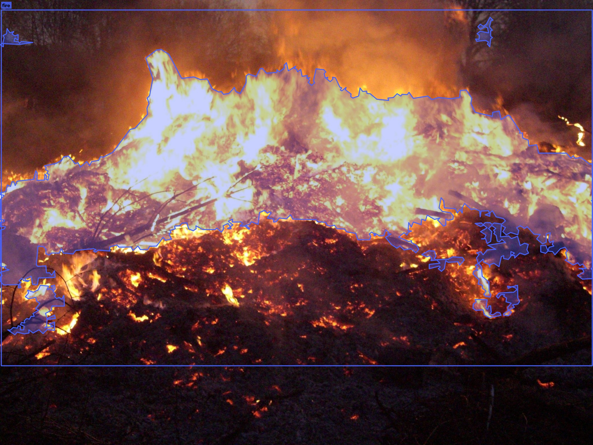
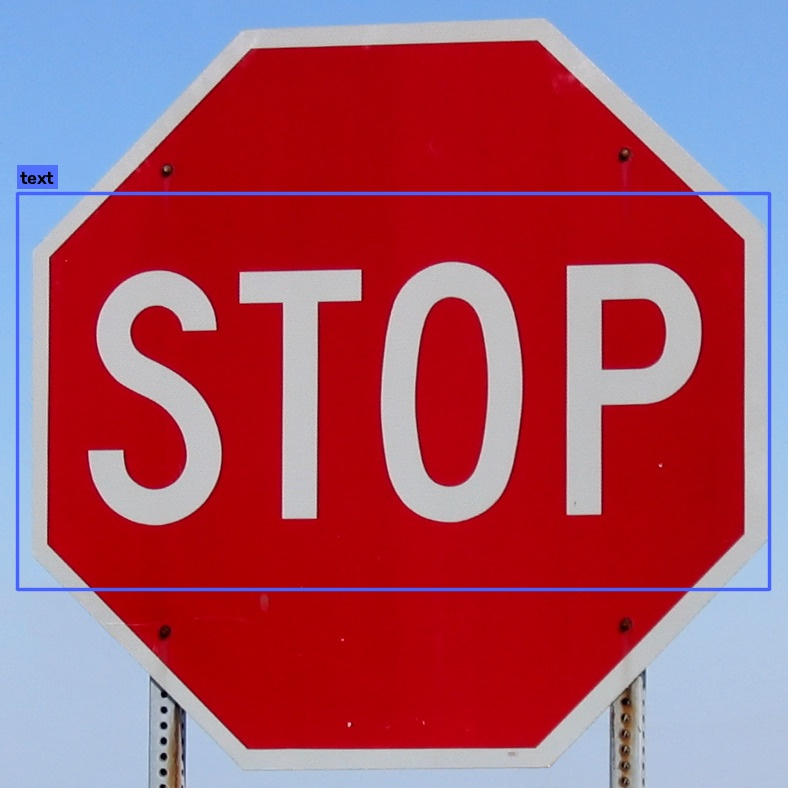
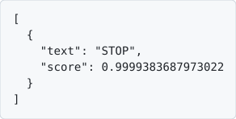
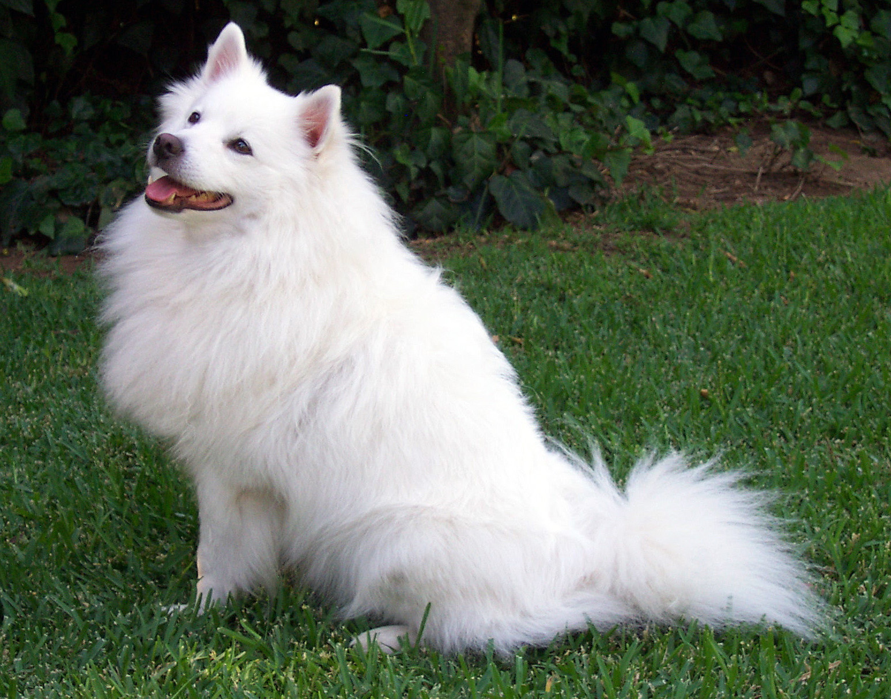
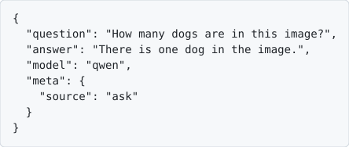
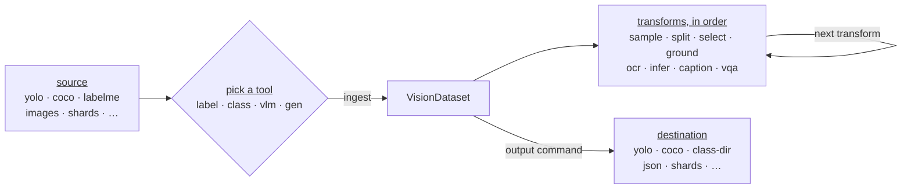

# cvsuite

[](https://pypi.org/project/cv-suite/ "PyPI release")
[](https://opensource.org/licenses/MIT "License: MIT")

`cvsuite` is a computer vision toolkit for reproducible, filesystem-to-filesystem dataset work, organized around one CLI:

```bash
cvsuite <branch> <src> [transform] <output>
```

- Convert between multiple annotation formats (YOLO, COCO, LabelMe, class folders, segmentation masks, VQA manifests). 
- Auto-label raw images from a text prompt with foundation grounding models (fm) such as SAM 3 or Grounding DINO. 
- Collect caption from images or answer questions about them with vision-language models. 
- Sort files into class folders with zero-shot classifiers. 
- Read text off with OCR. 
- Generate and edit images with diffusion models. 
- Then do the unglamorous half of the job: unzip and flatten a dump of files, drop exact and near-duplicates, fix orientation, normalize size and format, and draw a balanced sample for training.

```bash
cvsuite label ./dataset-yolo to-coco ./dataset-coco
cvsuite label ./images ground --provider gsam --prompt "fire" to-results ./labeled
cvsuite vlm ./images caption --provider qwen to-json ./captions
cvsuite class ./images infer --provider clip --prompt "good,bad" to-class-dir ./sorted
cvsuite gen create --provider flux --prompt "a red fox in the snow" to-dst ./fox.png
cvsuite prep arrange ./dump ./clean --unzip --exact-dedup --rename-seq
```

### Examples

To generate these examples locally, run [`./scripts/generate_examples.sh`](scripts/generate_examples.sh).

**Image Generation (`cvsuite gen`)**

```bash
cvsuite gen create --provider stable_diffusion --precision fp16 --prompt "a red fox in the snow" to-dst ./fox.png
```


**Zero-Shot Grounding (`cvsuite label ground`)**

```bash
cvsuite label ./images ground --provider gsam --prompt "fire" to-results ./labeled
```



**OCR Text Detection (`cvsuite label ocr`)**

```bash
cvsuite label ./images/ocr.jpg ocr --provider paddleocr to-results ./ocr-out
```



Recognized text:



**Visual Question Answering (`cvsuite vlm ask`)**

```bash
cvsuite vlm ./images/dog.jpg ask --prompt "How many dogs are in this image?" --provider qwen to-json ./answers
```



Generated answer (see [`docs/example_data/answers/dog.json`](docs/example_data/answers/dog.json)):



More in the [cookbook](https://github.com/ptonso/cv-suite/blob/main/docs/cookbook.md).

You point a branch at a source, optionally run a transform, and materialize a destination layout. There is deliberately no universal "convert anything to anything" command.

## How it works



Whichever tool you pick, the spine is the same: the source is ingested into a shared `VisionDataset`, transforms mutate that dataset, and an output command materializes it. What differs per tool is the ingest heuristics, which transforms exist, and the export rules.

A run applies any number of transforms, left to right, before the output command: `cvsuite label ./raw sample --count 500 split --val-frac 0.2 to-yolo ./out`. FM-backed transforms (`ground`, `ocr`, `infer`, `caption`, `vqa`, and the `gen` actions) hand the dataset to an isolated provider subprocess that mutates records in place; a chain holds at most one, and it comes first. `cvsuite prep` is the exception to all of this, since it works directly on folders and never builds a dataset.

## Branches

| Branch | Purpose |
|---|---|
| `cvsuite label` | annotated datasets: YOLO / COCO / LabelMe / image-only ingest, `sample` / `ground` / `ocr` / `ops` / `filter` transforms, export to any label format |
| `cvsuite class` | class-directory datasets: `infer` with zero-shot classifiers, class-aware `sample`, export via `to-class-dir` |
| `cvsuite vlm` | vision-language datasets: `caption` / `ask` / `vqa` / `map-answers`, export to flat JSON / shards / VQA-style |
| `cvsuite gen` | text-to-image and image-edit generation, materialized via `to-dst` |
| `cvsuite prep` | raw image folder cleanup: `arrange` / `process` / `sample` / `orient`, file-first |
| `cvsuite eda` | explore a dataset: image table, class and box statistics, health checks, near-duplicate twins across splits and metadata shortcuts as figures in a report folder (`pip install "cv-suite[eda]"`) |
| `cvsuite common` | shared operations: FM cache paths, inspection, and purge |

## Install

```bash
pip install cv-suite
```

Or from source:

```bash
git clone https://github.com/ptonso/cv-suite
pip install -e ./cv-suite
```

The base install ships the CLI and the I/O layer. Foundation-model backends run in isolated per-model virtualenvs provisioned on first use. See [`docs/getting-started.md`](https://github.com/ptonso/cv-suite/blob/main/docs/getting-started.md).

## Documentation

- [`docs/`](https://github.com/ptonso/cv-suite/tree/main/docs) contains the guides: the [mental model](https://github.com/ptonso/cv-suite/blob/main/docs/index.md), [getting started](https://github.com/ptonso/cv-suite/blob/main/docs/getting-started.md), and a [cookbook](https://github.com/ptonso/cv-suite/blob/main/docs/cookbook.md) of common workflows.
- [`specs/`](https://github.com/ptonso/cv-suite/tree/main/specs) is the technical source of truth: architecture, the dataset contract, per-branch behavior, and the constraints that must not break.

## Names

- PyPI distribution: `cv-suite`
- import package and CLI: `cvsuite`

## License

MIT. See [LICENSE](https://github.com/ptonso/cv-suite/blob/main/LICENSE).
